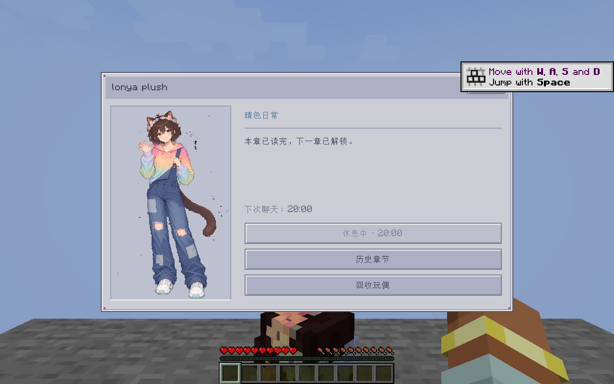

# lonya plush

Minecraft **1.21.1** / **NeoForge 21.1.219** 独立玩偶模组，当前版本 **1.1.2**，作者 **2i学习**。Mod ID：`lonya_plush`。

完整保留 Lonya 的玩偶物品、手持、头盔/可选 Curios 佩戴、摆件、活动实体、跟随、摸头、彩虹伞、眨眼，以及五章双人 Galgame。第四、第五章为手机通话；第五章在第四章选择正确回答后才出现。每章完成后默认休息 20 分钟，配置可关闭或调整。

当前源码新增两排四按钮菜单和按玩家保存的好感度：日常闲聊随机显示文字与表情，连续一分钟未闲聊后再次闲聊 +1；主线选项的好感度增减与分支对白由 JSON 配置；实体在主人 6 格内每累计 1 分钟 +1，还会收取主人丢在其 2 格内的钻石等贵重物品来增加好感度。拜访按钮直接继续主线，好感不足时在菜单对白位置提示所需数值与获取方式。五章拜访分别需要 20／40／60／80／100 点好感度，详见 [游戏操作](docs/USAGE.md)。`dist/` 中原有成品不包含这些新增改动，请使用下方构建命令生成最新 JAR。



## 直接安装

下载 [dist 中的成品 JAR](dist/lonya_plush-1.21.1-1.1.2.jar)，放进游戏的 `mods` 目录。需要 Minecraft 1.21.1 和 NeoForge；客户端、服务端使用相同版本，只保留一个 `lonya_plush` JAR。无需 AE2、Curios 或原万象担架；安装 Curios 时支持饰品佩戴。

`dist/` 是本次交接的 1.1.2 成品。后续源码修改的最新打包结果在 **Actions → Build Lonya plush → 具体运行 → Artifacts**，下载 ZIP 后取里面的 JAR。

## 给 Lonya 修改

请看 **[修改与构建指南](CONTRIBUTING.md)**，包括直接在 GitHub 修改、Fork、Actions 自动打包、改剧情、换皮肤/眨眼帧、换伞面和替换 CG。

| 要改什么 | 文件 |
| --- | --- |
| 各章对白、选项、分支和好感度变化 | [story 资源目录](src/main/resources/assets/lonya_plush/story)，主线文件为 `chapter1.json` 至 `chapter5.json` |
| 随机闲聊、表情和好感度范围 | [causal.json](src/main/resources/assets/lonya_plush/story/causal.json) |
| 便于整章写作的剧情源文件 | [rewrite_story.py](tools/rewrite_story.py)，用于恢复第 2–5 章原始主线对白并保留对应 JSON 分支；第一章以 `origin_story.md` 为准 |
| 皮肤、眨眼和伞面 | [textures/entity](src/main/resources/assets/lonya_plush/textures/entity) |
| 五章 CG | [textures/story](src/main/resources/assets/lonya_plush/textures/story) |
| 模组显示名和版本 | [gradle.properties](gradle.properties) |
| 物品、实体的显示名 | [lang](src/main/resources/assets/lonya_plush/lang) |
| 冷却默认值 | [LonyaStoryConfig.java](src/main/java/com/customdoll/lonya_plush/story/LonyaStoryConfig.java) |
| 游戏中的冷却配置示例 | [lonya_plush-common.toml](config-examples/lonya_plush-common.toml) |

## 冷却配置

首次启动后，游戏或服务器目录下会生成 `config/lonya_plush-common.toml`：

```toml
[chat]
cooldownEnabled = true
cooldownSeconds = 1200
```

`false` 关闭冷却；时长单位为秒，`1200` 是 20 分钟，`0` 无需等待。保存并重启游戏或服务器。此配置只控制章节拜访，闲聊始终可用，一分钟奖励间隔独立生效。冷却由服务端按玩家保存，离线时间继续计入；历史、CG 和回收不受影响，章内仍可自由翻页与快进。

## 构建

安装 JDK 21，在仓库目录执行：

```powershell
.\gradlew.bat build --console=plain
```

Linux/macOS 使用 `./gradlew build --console=plain`。可安装的 JAR 输出到 `build/libs/`，文件名带 `-sources` 的是源码包。推送或发起 Pull Request 后，GitHub Actions 也会自动打包。

[游戏操作](docs/USAGE.md) · [验证记录与边界](docs/VALIDATION.md) · [成品 SHA256](dist/SHA256SUMS.txt) · [MIT License](LICENSE)

源码和构建所需资源均在本仓库；图形化皮肤工具是独立工程。原万象担架工程不参与构建。
